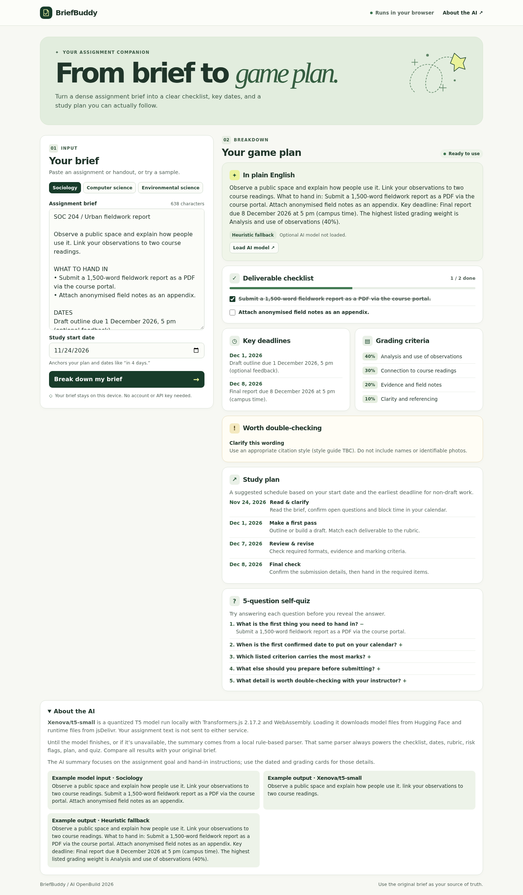
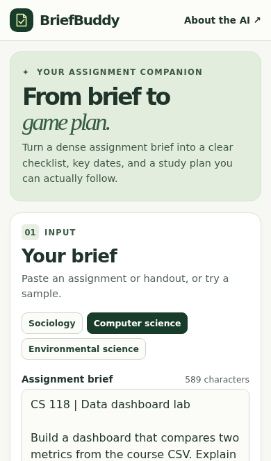
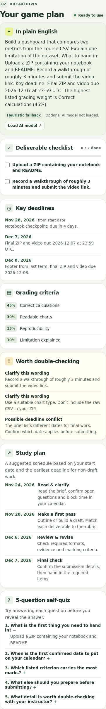
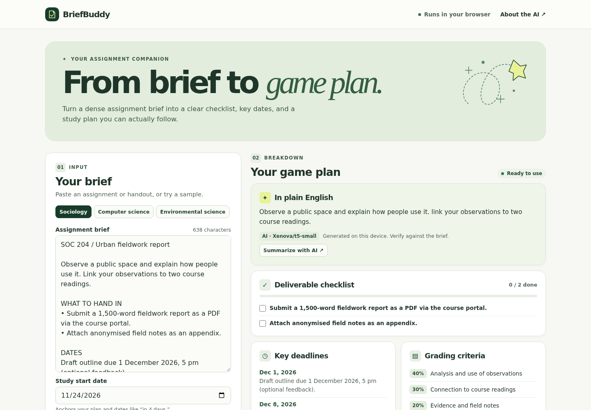

# BriefBuddy

**From brief to game plan.** BriefBuddy is a browser-based assignment companion for university students who lose track of deadlines, deliverables, or marking criteria buried in dense briefs and lecture handouts. It was built for [AI OpenBuild 2026](https://ai-openbuild.devpost.com/) as a solo student project with [Devin](https://devin.ai/) AI assistance for implementation, testing, and documentation.

**GitHub Pages URL:** [zq051031.github.io/ai-openbuild-2026](https://zq051031.github.io/ai-openbuild-2026/). The app also runs locally without a build, account, API key, or backend.

## Demo walkthrough

1. Choose **Sociology**, **Computer science**, or **Environmental science** to fill and analyze a sample immediately. For your own brief, paste plain text, choose a study start date, and select **Break down my brief**.
2. Read **In plain English**, tick a deliverable, then reload and reselect the same brief to see it stay checked. The browser stores checklist progress locally.
3. Compare the extracted **Key deadlines** and **Grading criteria** with the brief. Try **Computer science** to see a relative checkpoint and a warning for two conflicting final dates.
4. Follow the suggested **Study plan**, then open the five **self-quiz** answers one at a time.
5. Select **Load AI model** to download the optional model. The summary starts with a **Heuristic fallback** badge and changes to **AI · Xenova/t5-small** when the local model finishes. The other cards stay usable the whole time.

## What runs locally

| Part | Implementation |
| --- | --- |
| App | Static HTML, CSS, and JavaScript ES modules; no build step or runtime service |
| AI summary | [Xenova/t5-small](https://huggingface.co/Xenova/t5-small), a quantized ONNX conversion of [Google's T5-small](https://huggingface.co/google-t5/t5-small), in a Web Worker via [Transformers.js 2.17.2](https://www.npmjs.com/package/@xenova/transformers/v/2.17.2) and ONNX Runtime Web (WebAssembly) |
| Model providers | Hugging Face hosts the weights; jsDelivr serves the pinned library and runtime. The first optional load needs network access and roughly 80 MB of model weights. Brief text is not uploaded. |
| Local parser | Plain JavaScript extracts source lines and percentage weights; resolves supported dates; flags common vague wording and conflicting final dates; and generates milestones and quiz answers. It always drives the structured cards and provides the initial summary. |
| Data | Three fictional, hand-authored demo briefs; no student records, dataset downloads, fine-tuning, or paid services. The upstream T5 model was pretrained on C4; BriefBuddy uses pretrained weights. |

When the model is not loaded, loading, blocked, fails, or times out, the local parser still returns a summary and all five other views. The summary badge and status text show which engine is in use. After the model is ready, the app summarizes the next analyzed brief automatically. The model input focuses on detected objective and submission instructions when available; the deadlines and marking cards preserve the separate source details.

### Representative input and outputs

Model input derived from the built-in [Sociology brief](./samples.mjs):

> Observe a public space and explain how people use it. Link your observations to two course readings. Submit a 1,500-word fieldwork report as a PDF via the course portal. Attach anonymised field notes as an appendix.

**Xenova/t5-small output, captured verbatim in headless Chrome:**

> Observe a public space and explain how people use it. link your observations to two course readings.

**Heuristic fallback output for the same full brief:**

> Observe a public space and explain how people use it. Link your observations to two course readings. What to hand in: Submit a 1,500-word fieldwork report as a PDF via the course portal. Attach anonymised field notes as an appendix. Key deadline: Final report due 8 December 2026 at 5 pm (campus time). The highest listed grading weight is Analysis and use of observations (40%).

### Failure cases and limitations

- The model can omit important details: the output above leaves out both the PDF and the appendix. Use the checklist and original brief for submission requirements, not the model summary alone.
- Ambiguous numeric dates such as `03/04/2027` are left unconfirmed unless the brief names its date order. A relative date such as “in 4 days” is measured from the start date you select, which may not be when the instructor issued the brief.
- Parenthetical date notes, such as feedback release dates or alternate submission dates, can be misclassified; check the **Key deadlines** card against the original brief.
- Unlabeled instructions, scanned handouts, complex tables, and unweighted rubrics can be missed. Paste readable English text; there is no file upload or OCR. A plan based on an inferred date or conflicting dates is not authoritative. If no date can be parsed, the seven-day plan is explicitly provisional.

## Screenshots

**Desktop — Sociology breakdown with a checked deliverable and open quiz answer**



| Mobile brief editor | Mobile breakdown |
| --- | --- |
|  |  |

**Browser model result**



## Run and test

From the repository root:

```sh
python3 -m http.server 8000
```

Open [localhost:8000](http://localhost:8000). A static host is needed to serve browser modules; there is no application server. For the dependency-free parser tests, run `node --test` with Node.js 22:

| Built-in brief | Checklist items | Dated entries | Rubric weights | Verified risk | Plan target | Quiz |
| --- | ---: | --- | --- | --- | --- | ---: |
| Sociology | 2 | Dec 1, Dec 8 | 40%, 30%, 20%, 10% | Citation style TBC | Dec 8 | 5 |
| Computer science | 2 | Nov 28, Dec 7, Dec 8 | 45%, 30%, 15%, 10% | Conflicting final dates | Dec 7 | 5 |
| Environmental science | 3 | Dec 4, Dec 6 | 35%, 30%, 25%, 10% | Presentation details unconfirmed | Dec 4 | 5 |

All sample dates use 2026 and the built-in start date of November 24. **5 automated tests passed**: the three samples plus edge cases for invalid and ambiguous dates, relative dates, missing deadlines, and past deadlines. Headless Chrome was used to check all three sample flows and answer reveals, pasted input and relative dates, checklist persistence after reload, and the mobile flow at 390 px. The optional model was run in Chrome to capture the result above. Blocking the CDN in Chrome left the fallback summary and checklist usable and displayed a retry message.

The project code is [MIT licensed](./LICENSE); model weights are served separately by their provider.
